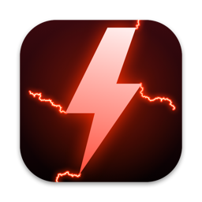
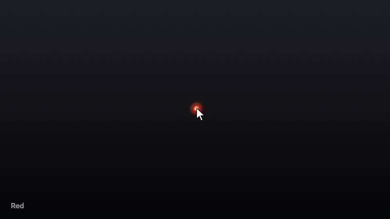
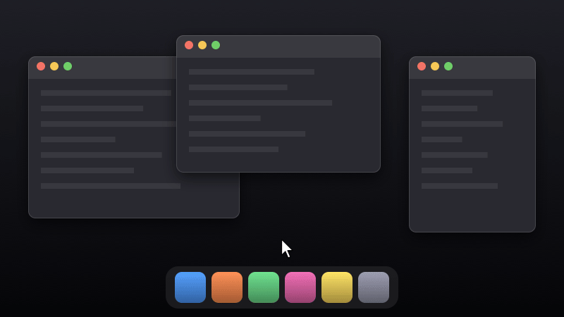
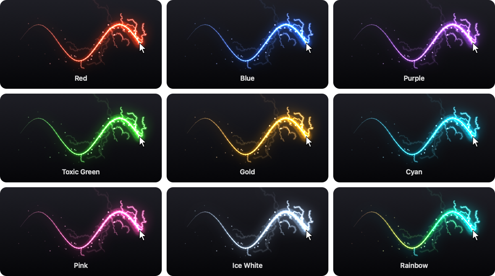

<p align="center"></p>

<h1 align="center">LightTrail</h1>

<p align="center">Your mouse leaves a trail of crackling lightning that fades away in under half a second.</p>

<p align="center"><a href="https://github.com/Mrkh97/light-trail/releases/latest/download/LightTrail.zip"><b>Download for macOS</b></a> · macOS 13 Ventura or later · Apple silicon and Intel</p>



LightTrail draws over everything on your screen, but you can't see or click it: it never gets in the way of the app you're using, has no Dock icon and needs no permissions. Move slowly and you get a thin glowing line. Flick the mouse and it throws off forked bolts, sparks and the occasional thunder strike. Turn on **Lightning Strikes** and bolts jump from the pointer to the edges of nearby windows, and if you like, to buttons and icons too.

## Install

### Homebrew

```sh
brew install --cask mrkh97/tap/lighttrail
open -a LightTrail
```

Update with `brew upgrade --cask lighttrail`. If you installed LightTrail by hand before, add `--force` the first time so Homebrew can replace that copy.

### Download

1. Download [**LightTrail.zip**](https://github.com/Mrkh97/light-trail/releases/latest/download/LightTrail.zip) from the [latest release](https://github.com/Mrkh97/light-trail/releases/latest) and unzip it.
2. Drag **LightTrail.app** into your **Applications** folder and open it.

LightTrail is signed with a Developer ID and notarized by Apple, so it opens like any other downloaded app.

### First run

Move your mouse. The bolt icon in the menu bar is where the settings are.

LightTrail turns on **Start at Login** the first time you open it, so it's there every time you log in. Turn it off in its menu if you'd rather start it yourself. macOS may show a notification that LightTrail added a login item.

### Build from source

You need macOS 13 or later and Xcode or the Xcode command line tools (`xcode-select --install`).

```sh
git clone https://github.com/Mrkh97/light-trail.git
cd light-trail
./build.sh --install    # builds LightTrail.app, copies it to /Applications and launches it
```

`./build.sh` alone just builds `build/LightTrail.app`. `./build.sh --release` makes a universal (Apple silicon + Intel) build, notarizes it and zips it as `build/LightTrail.zip`. If your keychain has a Developer ID Application certificate, the app is signed with it; otherwise it's ad-hoc signed, which is fine for running it on your own Mac. The comments at the top of `build.sh` explain how to set up notarizing.

### Uninstall

Turn off **Start at Login** in its menu first. Then:

- **Homebrew:** `brew uninstall --cask lighttrail`, or `brew uninstall --cask --zap lighttrail` to also forget its settings.
- **By hand:** quit LightTrail from its menu and drag LightTrail.app to the Trash. To also forget its settings: `defaults delete dev.lighttrail.app`.

If you allowed Accessibility for **Strike Buttons and Icons**, remove LightTrail from System Settings > Privacy & Security > Accessibility too, or run `tccutil reset Accessibility dev.lighttrail.app`.

## What it does

- **A glowing trail** with a white-hot core follows the pointer and tapers away behind it. The faster you move, the thicker and brighter it gets.
- **Electricity crawls along the trail**, flickering every frame.
- **Forked lightning** tears off the pointer as you move, and small crackles jump off the trail.
- **Thunder strikes:** a really fast flick throws a big branching bolt with a flash of light.
- **Sparks** fly off behind the pointer and fall.
- **It all fades** within about half a second of the mouse stopping, and nothing is drawn while the mouse is still.

It works on every display, in every Space and over full-screen apps. It only reads where the pointer is, so it doesn't need Accessibility or Screen Recording permission.

### Lightning strikes



Turn on **Lightning Strikes** in the menu and the pointer becomes the source: as you move it, bolts jump to the edges of nearby windows. Each bolt stays hooked to the pointer and slides along the edge as you move, with electricity crawling along the edge where it lands. It works alongside the trail, or on its own if you turn **Trail** off.

- **Closer things get struck more often.** Lightning reaches about 170 points when you move slowly and about 290 when you move fast.
- **Faster means more.** Moving slowly keeps two or three arcs going; a quick swipe throws up to seven at once.
- **Only what you can see.** Edges hidden behind other windows are never struck, and neither is the border of your display.
- **Nothing while the mouse is still.** Strikes fade within half a second once you stop.

Window positions don't need any permission. **Strike Buttons and Icons** goes further: bolts also hit buttons, toolbar icons, menu bar items and the Dock, and the icon they hit lights up around its edge. To see those, LightTrail asks macOS for **Accessibility** permission the first time you turn it on. It only uses it to find where buttons and icons are near the pointer. If you don't allow it, strikes keep hitting window edges. To allow it later, choose **Allow in Accessibility Settings…** in the menu.

### Nine colors

<p align="center"></p>

**Rainbow** cycles through the hues as you move, so each swipe is a gradient.

## The menu

Click the bolt in the menu bar:

| | |
|---|---|
| **Pause / Resume** | Hide everything without quitting (⌘P while the menu is open) |
| **Trail** | The glowing trail with its bolts and sparks. On by default |
| **Lightning Strikes** | Bolts jump from the pointer to nearby window edges. Off by default |
| **Strike Buttons and Icons** | Also strike buttons, icons, menu bar items and the Dock. Needs Accessibility permission. Shown as **–** while it's waiting for the permission |
| **Color** | Pick one of the nine colors. LightTrail remembers it, along with the other choices here |
| **Start at Login** | Open LightTrail when you log in |
| **Quit LightTrail** | |

## How it works

LightTrail is one small Swift app with no dependencies. It puts a transparent, click-through window over each display, reads the pointer position 120 times a second and redraws only the part of the screen the effect covers. Everything is drawn with Core Graphics: layered strokes for the trail, one shared shadow for the colored bloom, and additive blending so overlapping light gets brighter, like real light.

| Piece | File |
|---|---|
| The overlay windows, frame loop and menu | `App.swift` |
| The trail, bolts, strikes and sparks: when they appear, how they move and fade | `Engine.swift` |
| Finding what strikes can hit: window edges, buttons and icons | `Targets.swift` |
| Drawing all of it into a Core Graphics context | `Renderer.swift` |
| The nine colors (every shade is mixed from one base color) | `Theme.swift` |
| Timings and sizes you can tweak | `Config.swift` |
| The app icon and the README pictures | `Showcase.swift` |

**Lightning** is made by midpoint displacement: start with a straight line, push its midpoint sideways by a random amount, and repeat on each half with smaller and smaller pushes. Branches split off the main bolt the same way.

**Speed sets the energy.** Every point of the trail remembers how fast the mouse was going when it was laid down. That decides its thickness, how much electricity crawls over it and how often bolts and sparks are thrown.

**Strikes find their targets** on a background thread about 20 times a second, and only while the mouse moves, so drawing never waits on them. Window edges come from the list of windows on screen, with the parts covered by other windows cut away. Buttons and icons come from asking Accessibility what's under a few random spots around the pointer, every other time; what it finds is remembered for a moment, so the area around the pointer fills in quickly. A strike keeps the same shape while the pointer drags it around, and takes a new one every few hundredths of a second, so it flickers like a real arc.

### Make it your own

The numbers at the top of `Config.swift` set how long the trail lasts (`trailLife`), how thick it is (`trailWidth`), how fast you have to move for full power (`speedForMaxEnergy`), how far strikes reach (`strikeReach`) and how many there can be at once (`maxStrikes`). To add a color, add a case to `Theme` in `Theme.swift` with its base color. Then run `./build.sh --install`.

### Developer flags

```sh
.build/release/LightTrail --icon icon.png       # render the app icon
.build/release/LightTrail --colors colors.png   # render the color sheet
.build/release/LightTrail --demo frames         # render the demo animation as PNG frames
.build/release/LightTrail --strikes-demo frames # render the lightning strikes animation as PNG frames
.build/release/LightTrail --targets             # list what strikes could hit around the pointer right now
.build/release/LightTrail --targets --at 300,900   # ...or around another spot (points from the bottom left)
docs/make-visuals.sh                            # repaint all the README pictures (needs ffmpeg)
```

The pictures are drawn by the real engine and renderer, following a scripted pointer path, so they look exactly like the app. In the strikes animation the windows and Dock are drawn for the picture, but the edges and icons the lightning aims at are worked out the same way as on your screen. `--targets` lists buttons and icons only if the app running it (your terminal, say) has Accessibility permission.
